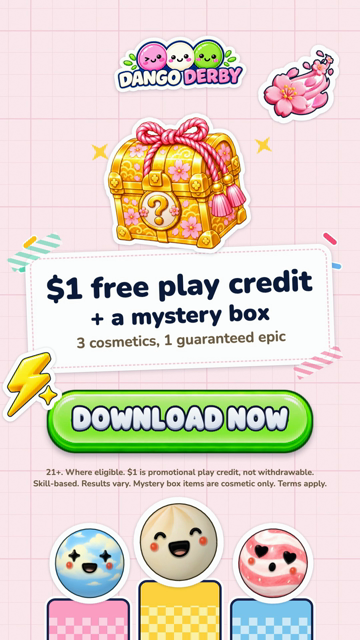

# endcard

The official Dango Derby end card, and the tools that put it on an ad: the skill `dango-derby:endcard`. To install
and set up the plugin, see the plugin's [`README.md`](../../README.md).

## What it is for

Every Dango Derby ad ends on the same card, so that every ad makes the same offer in the same words. Before this
skill, each person kept a copy of the card and the join script on their own Mac, and older ads still had a card that
promised 5 cosmetics instead of 3. This skill ships the one card file with the plugin, joins it to any finished
vertical ad with the ball-roll wipe, checks that ads end on it, and swaps the old card out of older ads.

Anyone on the team runs it on a Mac, on the ads they are about to share. It calls no API and costs nothing.

## Creatives it makes

### Ad with end card

The finished ad, then a big Sakura dango rolls right to left across the frame (0.5 s) and reveals the pink
sticker-book card: the Dango Derby logo, a mystery chest, "$1 free play credit + a mystery box", "3 cosmetics, 1
guaranteed epic", the DOWNLOAD NOW button, the legal footer and 3 dango on podiums. The card's music fades out over
its 7 s.

- **Output:** `With End Card/<same name>.mp4`, 1080×1920, 60 fps, H.264 + AAC, the ad's length + 6.75 s.
- **Use:** every Dango Derby video ad, on every platform.
- **Cost:** none.

The playbook is [`SKILL.md`](SKILL.md): a checklist with the 3 steps, then the details of each step.

## Add the end card

Open Claude Code and say something like:

> Add the Dango Derby end card to every video in ~/Downloads/Dango Ads - Signed Off.

or

> Check that all the ads in this folder have the right end card.

## Known issues

1. **Only the old pink card can be swapped in place.** A video with the old lemon or gift-box card has to be made
   again from its version without an end card.
2. **The card's music is fixed.** It is the music tail that the card was made with. An ad with other music still ends
   on it.
